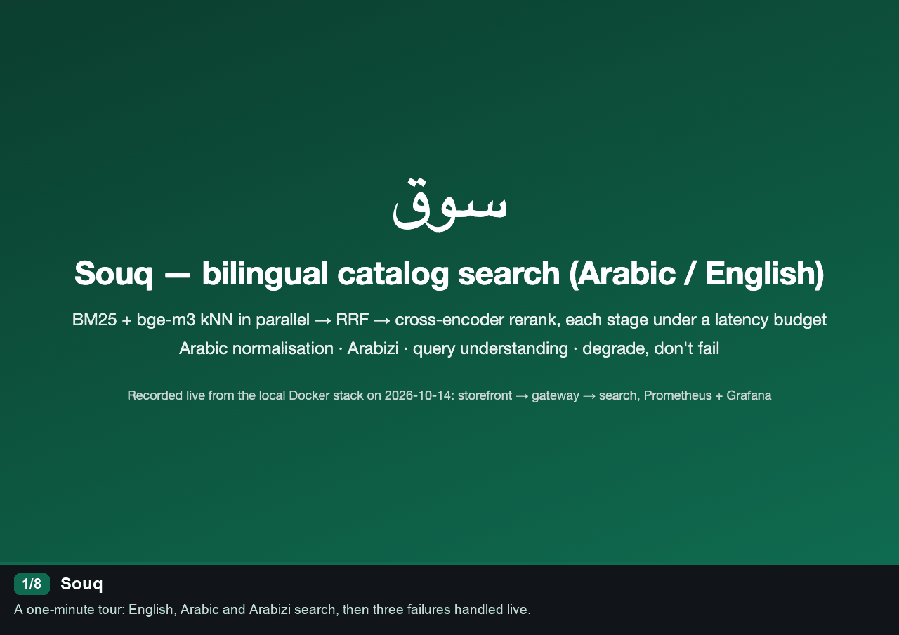
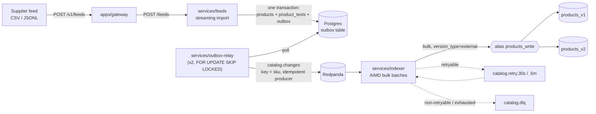
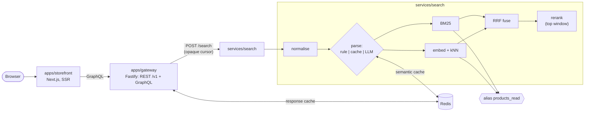

# Souq: bilingual (Arabic/English) catalogue search

Souq is a working reference implementation of e-commerce search over a catalogue that is half English and
half Arabic. It covers the parts that usually stay out of demos:

- **Arabic-aware retrieval.** One normalisation module (tashkeel, alef/ya/ta-marbuta folding, Arabic-Indic
  digits, Arabizi transliteration) mirrored exactly by the OpenSearch analyzers.
- **Hybrid ranking.** BM25 and bge-m3 kNN run in parallel, then reciprocal-rank fusion, then an int8
  cross-encoder reranker over the top window, each stage under a latency budget.
- **Query understanding.** A deterministic rule parser extracts price, brand, colour, size and category. An LLM
  parser (with a semantic cache) handles what the rules can't, within a token and latency budget. On failure
  it falls back to the rule result instead of erroring.
- **A real indexing pipeline.** Feed import → Postgres with a transactional outbox → relay → Redpanda →
  indexer with AIMD backpressure, retry topics and a DLQ → versioned OpenSearch indices behind aliases
  (zero-downtime reindex).
- **Evals that gate CI.** nDCG/Recall/MRR per language slice and per ablation, filter-parse accuracy,
  latency and LLM cost, all compared against main.

Everything runs locally on Docker. No LLM key is needed to run or test it: LLM calls replay fixtures
recorded from the live model (Claude Haiku 5.5); set `ANTHROPIC_API_KEY` and `SOUQ_LLM_MODE=live|record` to
call it for real.

## Demo



One minute of the running stack, recorded by [`scripts/demo/record_demo.py`](scripts/demo/record_demo.py):
English, Arabic (RTL) and Arabizi queries with the parsed-filter panel; a tampered page token handled by
restarting the search (**page retry**); real load opening the reranker's circuit breaker so results come back
in fused order with a notice (**reranker degrade**); and a burst above capacity answered with immediate
`503` + `Retry-After` while admitted requests stay fast, then recovery (**storm shed**). Nothing in it is
mocked.

## Architecture

### Indexing path (feed → searchable)



Each feed row commits atomically with its outbox event, and the event carries the full product document
(`product_document(sku)`) plus `products.version`. Delivery is at-least-once. The indexer writes with
external versioning, so duplicates and out-of-order events converge to the newest version (a 409 counts as
success). Trace context travels from the feed request through `outbox.trace_context` into Kafka headers, so one
trace links import, relay and indexing.

### Query path



The gateway never talks to OpenSearch and never reorders results. Ranking and pagination semantics belong to
the search service; the gateway signs its cursors into tamper-proof page tokens. Every stage has a budget in
[`config/budgets.yaml`](config/budgets.yaml). A stage that runs over budget is skipped and reported in
`degraded` (`rerank`, `llm_parse`, `knn`, ...), and the storefront shows a notice instead of failing.

More detail, including why the outbox relay is Python: [docs/architecture.md](docs/architecture.md).

## Targets vs measured

<!-- report:targets:start -->
_Generated by `ci/readme_report.py` at commit `fba26f5` from: eval full `20261014T075812Z-full` (2026-10-14 07:58 UTC); eval offline `20261014T075406Z-offline` (2026-10-14 07:58 UTC); k6 run 2026-10-14 08:10 UTC; reranker bench (date not recorded)._

| Area | Target | Value | Measured | Status | Source |
|---|---|---|---|---|---|
| Relevance | nDCG@10 lift over BM25, English slice | ≥ +5 points | +5.8 points (rrf_rerank_llm 0.610 vs bm25 0.552) | ✅ | `docs/reports/eval-full.json` |
| Relevance | nDCG@10 lift over BM25, Arabic slice | ≥ +10 points | +22.3 points (rrf_rerank_llm 0.460 vs bm25 0.236); 100 % of judgments not human-labelled (claude 2,078) | ⚠️ | `docs/reports/eval-full.json` |
| Relevance | Recall@100, all slices | ≥ 0.90 | 0.685 (rrf_rerank_llm); 61 % of judgments not human-labelled (claude 2,785) | ❌ | `docs/reports/eval-full.json` |
| Relevance | Zero-result rate, all slices | ≤ 2 % | 0.0 % (rrf_rerank_llm) | ✅ | `docs/reports/eval-full.json` |
| Query understanding | Filter-parse exact match | ≥ 92 % | 100.0 % (rule+llm, n=80); rule parser alone 90.0 % | ✅ | `docs/reports/eval-full.json` |
| Latency | Standard path p95 at 200 RPS (k6, at the gateway) | ≤ 250 ms | 1,609 ms (200 RPS offered, 182.5 achieved); errors 83.4 % | ❌ | `docs/reports/k6-200rps-summary.json` |
| Latency | LLM path p95 (k6) | ≤ 1.2 s | 1,775 ms; no request took the LLM path (the trend holds long-tail requests that fell back) | ❌ | `docs/reports/k6-200rps-summary.json` |
| Latency | Reranker top-30 p95 | ≤ 120 ms | 105.1 ms (mmarco-mMiniLMv2-L12-H384-v1-int8, load avg 1.9); 561.6 ms at load avg 28.5 | ⚠️ | `docs/reports/reranker-bench.json` |
| Cost | Share of traffic on the LLM path | ≤ 10 % | 0.7 % (1 of 150 golden-set queries); k6 traffic mix 0.0 % | ✅ | `docs/reports/eval-full.json`, `docs/reports/k6-200rps-summary.json` |
| Cost | LLM tokens per LLM-path query | ≤ 1.5k | 1,391 (input + output, 7 requests, claude-haiku-5-5) | ✅ | `docs/reports/usage.json` |
| Freshness | Index freshness p95 (feed commit → searchable) | ≤ 30 s | 8.3 s | ✅ | docs/reports/verification-2026-10-14.md |

✅ met · ❌ missed · ⚠️ met only under the caveat in the Measured column, or not measured.
<!-- report:targets:end -->

Generated by [`ci/readme_report.py`](ci/readme_report.py) from the eval reports, the k6 summary and the
reranker benchmark committed under [`docs/reports/`](docs/reports/); the stamp gives the commit and date the
numbers were measured at. Regenerate with `uv run python ci/readme_report.py --write README.md ...` (see the
script). `evals/thresholds.yaml` holds regression floors from the first dev run, not these targets; CI also
blocks a > 1.0 point nDCG@10 drop on any language slice vs main. Full latency write-up, including the five
overload bugs found while measuring: [`docs/perf-report.md`](docs/perf-report.md).

### Known bias in the relevance numbers

- **English labels are Amazon ESCI's** (human, Amazon US shoppers and catalogue): Exact / Substitute /
  Complement / Irrelevant → gains **3 / 2 / 1 / 0**. Not a Gulf marketplace.
- **Arabic results are measured against machine-translated titles.** 10,767 of 51,001 products carry an
  Arabic title translated by Claude Haiku 5.5 (Message Batches, strict JSON output); the rest have none. A
  reviewed sample of 100 was **50 ok / 38 minor / 12 wrong** (a first, free-text run was 30 % wrong — mostly the
  model's own notes leaking into titles — and was discarded). MT Arabic is more regular than real supplier
  Arabic, which probably flatters lexical matching on the Arabic slice.
- **The Arabic and Arabizi/mixed slices were graded by Claude, not hand-labelled.** The maintainer asked
  Claude to label them; the 2,785 grades are stored as `label_source: claude` and every eval report says so.
  They measure agreement with a model's judgement, not a shopper's. The misspelled-English queries keep
  ESCI's human labels where ESCI judged the pair. Claude's grades agree exactly with ESCI's grade for the
  English source query on 54–69 % of judged pairs per batch.
- **The LLM-judge kappa gate was calibrated against those Claude labels** (50 stratified pairs): Haiku judge
  vs Claude labels scored **κ = 0.599**, under the 0.6 bar, so the judge was refused. Even a pass would have
  measured model–model agreement.
- Arabic and English numbers are not directly comparable; treat the Arabic lift as directional.

## Eval methodology

150 golden queries — **60 English** (ESCI), **60 Arabic**, **30 Arabizi / misspelled / mixed-script** —
with **4,550 graded judgments** (1,553 ESCI; 2,785 Claude; 212 ESCI on misspelled queries), plus **80
filter-parse cases** (price, currency, brand, colour, size, category). The corpus is every judged product
plus 5,000 seeded distractors, force-merged so runs are deterministic. Ablations: BM25, kNN, RRF, RRF +
rerank, + LLM parse; metrics nDCG@10, Recall@100, MRR, zero-result rate, filter exact match, per-stage
p50/p95, LLM-path share and USD per 1k queries — all per language slice. Details, label provenance and how
thresholds were chosen: [`docs/evals-methodology.md`](docs/evals-methodology.md).

## Cost

<!-- report:cost:start -->
_Generated by `ci/readme_report.py` at commit `fba26f5` from `docs/reports/usage.json` (2026-10-14 07:30 UTC) and `config/pricing.yaml` (list prices as of 2026-10-06)._

| Unit of work | Model | Requests | Input tokens | Output tokens | Batch | USD | Note |
|---|---|---|---|---|---|---|---|
| 1k searches | `claude-haiku-5-5` | 7 | 8,922 | 400 | no | $0.0011 | LLM parse on 0.67 % of golden-set searches (eval share; production share not measured); per-call tokens from 13 recorded live calls |
| 1k titles translated | `claude-haiku-5-5` | 1,000 | 370,260 | 50,135 | yes | $0.0310 | Message Batches msgbatch_019beVXX9dMXG1iY9kLeHjS9 (9,741 requests, strict JSON output); an earlier free-text run of the same size (1.58M in / 0.69M out) was discarded after review |
| 1k judged pairs | `claude-haiku-5-5` | 1,000 | 403,280 | 8,800 | no | $0.0447 | LLM-judge calibration run, 50 recorded calls (kappa gate refused at 0.599) |

- `claude-haiku-5-5`: $0.10 input / $0.50 output per million tokens; batch requests × 0.5.
<!-- report:cost:end -->

Priced from [`config/pricing.yaml`](config/pricing.yaml); token counts are from real calls (recorded parser and
judge fixtures, the translation batch's usage) in [`docs/reports/usage.json`](docs/reports/usage.json).

## Architecture decisions

- [ADR 0001 — Redpanda + transactional outbox + Python relay](docs/adr/0001-queue-redpanda-outbox.md)
- [ADR 0002 — expand/contract migrations and versioned indices behind aliases](docs/adr/0002-migrations-expand-contract-and-index-aliases.md)
- [ADR 0003 — per-stage budgets and the degrade-don't-fail policy](docs/adr/0003-degradation-policy.md)

## What breaks first at 10×

Measured on one laptop (10 cores); 1× is 200 RPS and a 500k-SKU feed, 10× is 2,000 RPS and 5M SKUs.

1. **Search CPU breaks below 1×.** One node sustains roughly 60 RPS. With every request reranked, bge-m3 query
   embedding plus the cross-encoder cost ~180 ms of CPU per request; with reranking shed and query embeddings
   cached it is ~50 ms. So 200 RPS needs ~3–4 such nodes and 2,000 RPS ~35 (or GPUs) (derived).
   Admission control turns overload into fast `503` + `Retry-After` instead of collapse, but does not add
   capacity.
2. **The LLM parse path is over budget at any load.** Live Haiku 5.5 is p50 1.79 s / p95 2.92 s against an
   800 ms budget, so it always degrades to the rule parser, and the semantic cache never fills (it is written
   only after a successful parse). Fill it off the request path or give the path its own async budget.
3. **OpenSearch on one node** (768 MB heap; ~38 ms young-GC pauses): 5M × 1024-d vectors is ~20 GB.
4. **Re-embedding 5M SKUs** at 30–44 docs/s per 4 threads is 32–46 h; **feed import** at 480 rows/s is
   ~2.9 h per 5M rows (a per-row trigger is 56 % of it).

Evidence and fixes for each: [`docs/scaling.md`](docs/scaling.md).

## Quickstart

Prerequisites: Docker with about 8 GB for the VM, Node 24, pnpm 10, [uv](https://docs.astral.sh/uv/)
(Python 3.12 is fetched by uv if missing).

```bash
# 1. Install both toolchains (pnpm workspace + uv workspace)
pnpm install && uv sync --all-packages
cp .env.example .env

# 2. Core data services: Postgres :55432, Redis :6379, Redpanda :19092 (+ topics), OpenSearch :9200
docker compose -p souq -f infra/compose.yaml up -d --wait

# 3. Schema
pnpm --filter @souq/db migrate up        # tables, outbox, product_document()

# 4. Seed the catalogue into Postgres (seeds write no outbox events; the index is built from Postgres)
uv run souq-seed-esci                    # ~50k ESCI products + queries/judgments in data/esci/
uv run --package souq-scripts --extra translate souq-translate
                                         # Arabic titles: local MarianMT, or Claude when ANTHROPIC_API_KEY is set

# 5. Index: create products_v1, point products_read + products_write at it, backfill from Postgres
uv run souq-reindex --init v1            # later: --to v2 (zero-downtime), --rollback

# 6a. Run the apps in containers...
docker compose -p souq -f infra/compose.yaml --profile apps up -d --build --wait
# 6b. ...or on the host, one terminal each
uv run souq-search          # :8001
uv run souq-feeds           # :8002
uv run souq-outbox-relay
uv run souq-indexer
pnpm --filter @souq/gateway dev       # :4000
pnpm --filter @souq/storefront dev    # :3000

# 7. Live changes go through the pipeline: feeds -> outbox -> relay -> Redpanda -> indexer
uv run souq-feedgen --rows 1000       # data/feeds/supplier_1k.csv + .jsonl (+ manifest of deliberate rejects)
curl -H 'X-API-Key: dev-admin-key' -F file=@data/feeds/supplier_1k.csv -F format=csv \
  http://localhost:4000/v1/feeds        # 202 {id}; poll GET /v1/feeds/{id}, rejects at /v1/feeds/{id}/errors

open http://localhost:3000            # redirects to /en or /ar
```

Optional profiles: `--profile obs` (OpenTelemetry collector, Tempo, Prometheus on :9091, Grafana on :3001) and
`--profile tools` (Redpanda Console :8088, OpenSearch Dashboards :5601).

## Development

```bash
pnpm turbo build lint typecheck test     # everything, TypeScript and Python (Python via uv run)
pnpm test:integration                    # testcontainers / compose-backed suites, one package at a time,
                                         # then the cross-service suites in tests/
pnpm test:chaos                          # fault injection against the compose stack (tests/chaos)
uv run pytest -m "not integration and not live and not chaos"   # Python unit tests from the root
uv run pytest -m integration
pnpm codegen                             # OpenAPI/GraphQL codegen (packages/contracts)
```

- **One task graph, two toolchains.** Every Python uv member also has a thin `package.json` whose
  `lint` / `typecheck` / `test` scripts run `uv run ruff …`, `uv run mypy src` and `uv run pytest …`, so Turbo
  schedules and caches them with the TypeScript packages.
- **Test markers.** `integration` (containers), `live` (real LLM/API, never in default CI), `chaos` (fault
  injection), `slow`. Default `test` tasks exclude the first three. Jest tests tagged `@live` in their name are
  skipped unless `JEST_INCLUDE_LIVE=1`.
- **LLM record/replay.** `SOUQ_LLM_MODE=replay` (default) reads `tests/fixtures/llm/<key>.json`. `record` calls
  the API and writes fixtures (needs `ANTHROPIC_API_KEY`). `live` calls the API without writing.
- **Budgets.** All latency budgets are in `config/budgets.yaml`, read by Python (`souq_common.budgets`),
  the gateway and the storefront. Don't hard-code timeouts.
- **Contracts.** Kafka, Postgres, OpenSearch, internal API and telemetry contracts are listed in
  [CLAUDE.md](CLAUDE.md). Public API: `packages/contracts/openapi.yaml` and `schema.graphql`.

## Repository layout

| Path | What |
|---|---|
| `apps/gateway` | Fastify 5 public edge: REST `/v1`, GraphQL `/graphql`, page tokens, response cache, API keys |
| `apps/storefront` | Next.js App Router storefront: SSR search, facets, query interpretation, RTL Arabic |
| `services/search` | FastAPI search pipeline: normalise, parse, retrieve, fuse, rerank, paginate |
| `services/feeds` | Feed upload and streaming import into Postgres + outbox |
| `services/outbox-relay` | Outbox → Redpanda relay (Python, confluent-kafka) |
| `services/indexer` | Redpanda → OpenSearch bulk indexer, retry topics, DLQ admin CLI |
| `packages/contracts` | Public OpenAPI + GraphQL schema, internal specs, codegen, drift check |
| `packages/db` | Expand/contract SQL migrations |
| `libs/py-common` | `souq_common`: settings, budgets, telemetry, Arabic normalisation, embeddings |
| `libs/admin-sdk` | Generated Python admin SDK |
| `evals/` | Golden sets, filter-parse cases, harness, thresholds |
| `models/` | ONNX export/quantisation for the reranker and embedder |
| `scripts/` | Seeding (ESCI, translation, synthetic feeds), index templates, zero-downtime reindex |
| `infra/` | Compose stack and per-service config (Postgres init, Redpanda topics, OTel, Grafana, ...) |
| `tests/`, `loadtest/` | Cross-service integration and chaos tests; k6 load tests |

## Local ports

| Service | Port |
|---|---|
| Storefront / gateway / search / feeds | 3000 / 4000 / 8001 / 8002 |
| Postgres | 55432 (db/user/password `souq`) |
| Redis Stack | 6379 |
| Redpanda | 19092 Kafka, 18081 schema registry, 9644 admin |
| OpenSearch | 9200 |
| OTel collector | 4317 gRPC, 4318 HTTP |
| Tempo / Prometheus / Grafana | 3200 / 9091 / 3001 |
| Redpanda Console / OpenSearch Dashboards | 8088 / 5601 |

Host ports avoid 5432, 8080 and 9090 on purpose.
